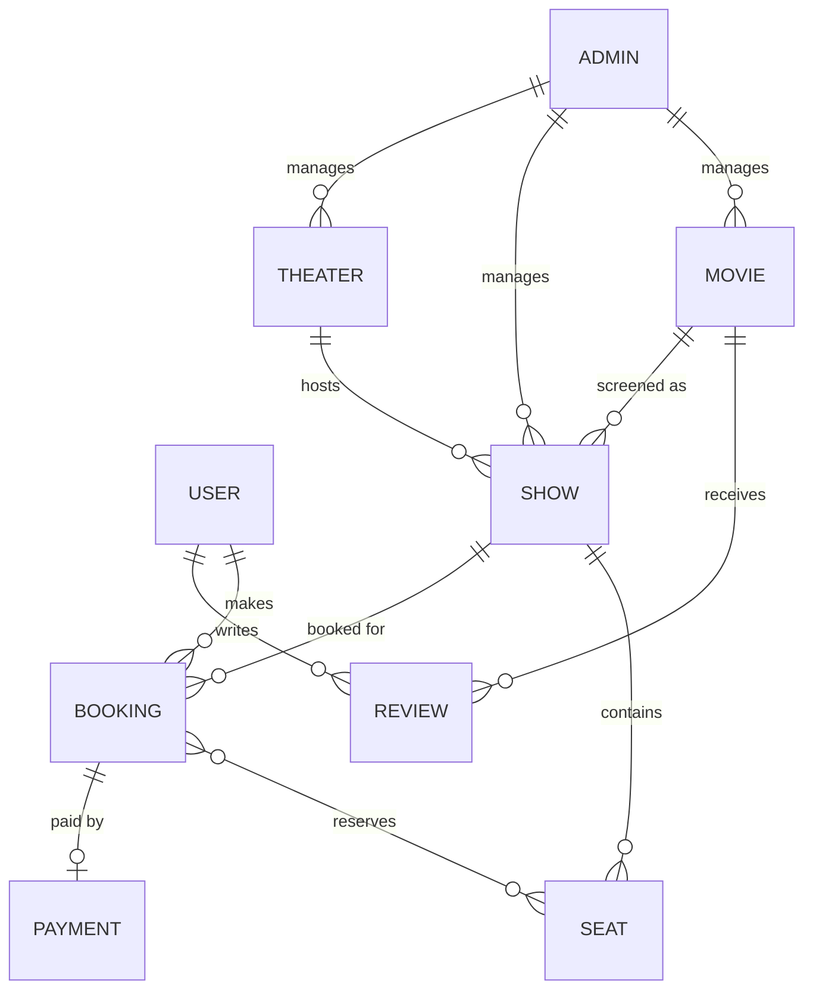
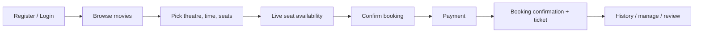

# IMovies — Movie ticket booking made simple

IMovies is a full-stack MERN application for browsing movies, comparing showtimes and reserving seats with real-time availability. It ships with JWT authentication, customer and admin roles, an interactive seat map, and server-side protection against double bookings.

| | |
|---|---|
| **Frontend** | React 19, Vite, Bootstrap 5, React Router |
| **Backend** | Node.js, Express 5, Mongoose |
| **Database** | MongoDB (local or Atlas) |
| **Auth** | JWT + bcrypt password hashing |
| **Tests** | Node test runner + Supertest, in-memory MongoDB for integration |

---

## Table of contents

- [Features](#features)
- [Technical architecture](#technical-architecture)
- [MVC pattern](#mvc-pattern)
- [ER diagram](#er-diagram)
- [Roles and responsibilities](#roles-and-responsibilities)
- [User flow](#user-flow)
- [Quick start](#quick-start)
- [Scripts](#scripts)
- [Project structure](#project-structure)
- [How seat locking works](#how-seat-locking-works)
- [Documentation](#documentation)
- [Deployment](#deployment)
- [Troubleshooting](#troubleshooting)

---

## Features

**Customers**

- Browse, search and filter movies by genre
- See showtimes grouped by date and theatre
- Live seat map with available, selected and booked seats
- Book up to 10 seats per transaction
- Booking reference and full booking history
- Cancel a booking before the showtime starts — seats are released instantly

**Admins**

- Create, edit and delete movies
- Manage theatres and screens (rows × seats, 2D/3D/IMAX/4DX)
- Schedule showtimes and cancel them
- Monitor every booking with revenue totals

**Engineering**

- Server-side validation of every seat against the screen layout
- A unique partial index guarantees two people cannot hold the same seat
- Centralised error handling and consistent JSON responses
- Seeded demo data (8 movies, 3 theatres, 7 screens, ~70 showtimes)

### Full feature scope

The project scope (as defined in the SkillWallet program) covers the following modules. Items marked *(planned)* are part of the design but not yet implemented in this repository.

| Module | Description | Status |
|---|---|---|
| User registration and authentication | Create accounts, log in securely and authenticate to access booking services | Implemented |
| Movie listings | Movies with title, genre, language, duration, ratings, cast and release date | Implemented |
| Theatre and show management | Admins manage theatres, screens and movie show schedules | Implemented |
| Seat selection and availability | View seat layouts, check availability and pick seats before booking | Implemented |
| Ticket booking management | Confirm bookings, manage reservations, view booking history | Implemented |
| Secure payment integration | Multiple payment options with transaction tracking (Razorpay / Stripe / PayPal) | *(planned)* |
| Watchlist and favourites | Save favourite or upcoming movies | *(planned)* |
| Reviews and ratings | Users submit reviews and ratings to help others decide | *(planned)* |
| Admin dashboard | Manage movies, theatres, bookings, users and reports | Partially implemented (movies, theatres, showtimes, bookings, revenue) |
| Notifications and alerts | Booking confirmations, ticket details, payment receipts and release alerts via email or SMS | *(planned)* |

---

## Technical architecture

IMovies follows a classic three-tier architecture, with optional layers for payments, real-time updates and deployment tooling.

### 1. Frontend layer (client-side)

**Purpose:** provide an interactive, responsive and intuitive interface for end users.

| Technology | Role |
|---|---|
| React.js / Vite | Build dynamic UI components |
| Bootstrap 5 | Responsive design and styling |
| React Router | Navigation between pages (Home, Movies, Shows, Seats, Bookings, Profile) |
| Axios | Communication with the backend REST API |
| JWT handling | Store the session token on the client |
| WebSockets *(optional)* | Real-time seat availability and booking updates |

**Key modules**

- User registration and authentication (login / signup)
- Movie and show browsing (filters by genre, language, location)
- Seat selection with live availability
- Booking management (view, cancel, reschedule)
- Profile and watchlist (favourites, history)
- Payment and ticket confirmation UI

### 2. Backend layer (server-side)

**Purpose:** manage business logic, security and data flow between the client and the database.

| Technology | Role |
|---|---|
| Node.js + Express.js | REST API framework |
| JWT authentication | Secure login and authorisation |
| bcrypt | Password hashing |
| Mongoose (ODM) | MongoDB schemas and queries |
| Socket.io *(optional)* | Real-time seat lock / unlock updates |

**Key services**

| Service | Responsibility |
|---|---|
| Auth service | Registration, login, JWT generation |
| User service | Profile management, favourites, history |
| Movie and show service | CRUD for movies, theatres and showtimes |
| Seat management service | Seat locking, booking confirmation |
| Booking service | Ticket booking, cancellations, refunds |
| Payment service | Integration with Razorpay / Stripe / PayPal *(planned)* |
| Notification service | Email / SMS reminders and confirmations *(planned)* |

### 3. Database layer

**Purpose:** persist and manage application data efficiently.

**Technology:** MongoDB — a NoSQL database chosen for scalability and flexibility.

| Collection | Contents |
|---|---|
| Users | Login details, profiles, preferences |
| Movies | Title, genre, language, poster, rating |
| Shows | Theatre ID, timings, available seats, pricing |
| Bookings | Booking details, seat numbers, payment status |
| Seats | Seat layouts and lock / unlock state |
| Payments | Transaction history and logs *(planned)* |
| Favorites | User watchlist and saved preferences *(planned)* |

> In the current implementation, shows are stored as **showtimes** and seat layouts are derived from **screens** (rows × seats) rather than a separate seats collection.

### 4. Payment gateway integration *(planned)*

**Purpose:** enable secure and seamless online payments.

**Options:** Stripe, Razorpay or PayPal APIs.

**Flow**

1. User selects a payment method.
2. Frontend calls the backend payment API.
3. Backend communicates with the payment gateway.
4. Gateway confirms the transaction and the backend updates the booking status.
5. Confirmation is sent to the user (email / SMS / notification).

### 5. Real-time seat management

**Purpose:** prevent double booking and provide live updates.

**Target flow**

1. User selects seats and the backend places a temporary seat lock (with a TTL).
2. On successful payment, seats are confirmed and marked as booked.
3. On failed or cancelled payment, seats are released automatically.
4. Socket.io / WebSockets notify other users of unavailable seats instantly *(optional)*.

The current build guarantees correctness with a unique partial index — see [How seat locking works](#how-seat-locking-works).

### 6. Deployment and infrastructure

**Purpose:** reliable hosting, scaling and CI/CD automation.

| Concern | Options |
|---|---|
| Frontend hosting | Vercel / Netlify / AWS S3 + CloudFront |
| Backend hosting | AWS EC2 / Render / Heroku |
| Database hosting | MongoDB Atlas (cloud) |
| CI/CD | GitHub Actions / GitLab CI for automated testing and deployment |
| Monitoring | PM2, log management, error tracking (Sentry, ELK Stack) |

### 7. Security

- HTTPS for all API requests
- JWT for authentication and authorisation
- Input validation and sanitisation (prevent XSS and injection attacks)
- Password hashing with bcrypt
- API rate limiting and throttling
- Role-based access control (Admin, User)

---

## MVC pattern

The backend is organised around the Model–View–Controller pattern, adapted for a REST API.

**Model layer (data layer)** — handles all data-related logic: schema definitions and the operations performed on the database. Models are implemented with Mongoose, which provides a schema-based solution for modelling MongoDB data. Located in `server/src/models/`.

**Controller layer** — acts as the intermediary between the routes and the models. It receives incoming requests, processes input (validation or transformation), calls the appropriate model methods and returns a response to the client. Located in `server/src/controllers/`.

**View layer (routing layer)** — in a backend REST API the view is the routing layer. Routes define the endpoints that respond to HTTP requests (GET, POST, PUT, DELETE) and invoke the matching controller functions. Located in `server/src/routes/`.

```text
Client request → Route → Middleware (auth, validation) → Controller → Model → MongoDB
                                                              ↓
Client response ← JSON ←──────────────────────────────── Controller
```

**Advantages of MVC in this project**

| Benefit | Why it matters |
|---|---|
| Separation of concerns | Each layer has a clearly defined responsibility, improving readability and maintainability |
| Scalability | New features are added by creating new routes, controllers and models |
| Reusability | Controller and model logic can be reused across the application |
| Testability | Each layer can be tested independently, especially controllers and models |
| Collaboration-friendly | Multiple developers can work on different layers without conflict |

---

## ER diagram

The data model is built around the following entities: **User, Admin, Movie, Show, Theater, Seat, Booking, Payment and Review**.

| Entity | Purpose | Key attributes |
|---|---|---|
| User | Foundation of the system; lets customers browse movies, book tickets, keep watchlists and write reviews | userId, name, email, phone, password |
| Admin | Manages the platform: movies, theatres and show schedules, and keeps seat availability accurate | adminId, name, email, password |
| Movie | A film that can be screened; linked to many shows | title, genre, language, duration, cast, release date |
| Show | Bridges movies and theatres | showtime, date, screen number, ticket price |
| Theater | A cinema location where movies are screened | name, location, available screens |
| Seat | An individual bookable seat belonging to a show; tracks allocation and availability | seat number, status |
| Booking | Stores a reservation and links user, show and seats | bookingId, booking date, selected seats, status, total amount |
| Payment | Linked to each booking; manages the transaction | paymentId, amount, method, status, date |
| Review | Lets users rate and give feedback on movies; admins can monitor it | rating, comment, date |

**Relationships**



**System connections**

- Movie → Show → Seat
- User → Booking → Payment
- Booking → Show → Seat
- User → Review → Movie
- Admin → Movie / Show / Theater management
- Payment → Booking confirmation

Together these entities support movie browsing, real-time seat booking, secure payment handling and efficient theatre management. See [`docs/er-diagram.md`](docs/er-diagram.md) for the diagram of the current implementation.

---

## Roles and responsibilities

### User

- Register and create a personal account
- Browse available movies and show timings
- Search and filter movies by genre, language and rating
- Select preferred seats and confirm bookings
- Make secure payments for ticket reservations *(planned)*
- Track booking history and upcoming shows
- Maintain watchlists and write movie reviews *(planned)*

### Admin

- Manage movies, theatres and show schedules
- Add, update or remove movie details and show timings
- Monitor seat availability and booking statuses
- Manage users and resolve booking-related issues
- Track payments and generate revenue reports
- Moderate user reviews and maintain platform integrity *(planned)*

---

## User flow

### Customer flow

1. User registers or logs into the system.
2. User browses available movies and selects a preferred movie.
3. User chooses a theatre, show timing and preferred seats.
4. System displays seat availability in real time.
5. User confirms the booking and proceeds with payment.
6. Payment is processed successfully and booking details are generated.
7. Booking confirmation and ticket details are sent to the user.
8. User can view booking history, manage reservations and write movie reviews.

### Admin flow

1. Admin logs into the system dashboard.
2. Admin manages movie listings, theatre information and show schedules.
3. Admin updates seat availability and monitors active bookings.
4. Admin tracks payments, booking reports and customer feedback.
5. Admin moderates reviews and ensures smooth platform operations.



See [`docs/user-flow.md`](docs/user-flow.md) for the flow of the current implementation.

---

## Quick start

### 1. Prerequisites

- Node.js 18 or newer (built and tested on Node 24)
- npm 9 or newer
- Git
- MongoDB — either a free **MongoDB Atlas** cluster or a local `mongod`

### 2. Install dependencies

```bash
npm run install:all
```

Or install each side separately:

```bash
cd server && npm install
cd ../client && npm install
```

### 3. Create the environment file

```bash
cd server
cp .env.example .env
```

Then edit `server/.env`:

```env
PORT=5000
NODE_ENV=development
MONGO_URI=mongodb+srv://<user>:<password>@<cluster>.mongodb.net/imovies
JWT_SECRET=<a long random string>
JWT_EXPIRES_IN=7d
CLIENT_URL=http://localhost:5173
ADMIN_NAME=IMovies Admin
ADMIN_EMAIL=admin@imovies.test
ADMIN_PASSWORD=Admin@12345
```

> The repository ships an `.env` pointing at `mongodb://127.0.0.1:27017/imovies`. If you use Atlas, replace `MONGO_URI` with your connection string.

**Getting an Atlas connection string**

1. Create a free account at <https://www.mongodb.com/cloud/atlas>.
2. Create a free M0 cluster.
3. Add a database user and allow your IP (or `0.0.0.0/0` while developing).
4. Click **Connect → Drivers** and copy the `mongodb+srv://...` string.
5. Append the database name, e.g. `.../imovies?retryWrites=true&w=majority`.

### 4. Seed the database

```bash
npm run seed
```

This clears the collections and creates demo movies, theatres, screens, showtimes and two sample bookings.

### 5. Run both apps

```bash
npm run dev
```

- Frontend: <http://localhost:5173>
- API: <http://localhost:5000/api/health>

Or run them in two terminals:

```bash
npm run dev:server
npm run dev:client
```

### Demo accounts

| Role | Email | Password |
|---|---|---|
| Customer | `demo@imovies.test` | `Demo@12345` |
| Admin | `admin@imovies.test` | `Admin@12345` |

---

## Scripts

| Command | What it does |
|---|---|
| `npm run dev` | Run API and React app together |
| `npm run dev:server` | API only, with file watching |
| `npm run dev:client` | Vite dev server only |
| `npm run seed` | Reset and seed demo data |
| `npm test` | Unit tests (no database needed) |
| `npm run test:integration` | Full API suite against an in-memory MongoDB |
| `npm run build` | Production build of the React app |

---

## Project structure

```text
.
├── client/                    React application
│   ├── src/
│   │   ├── components/        Shared UI + seat grid + admin panels
│   │   ├── context/           Auth context (JWT session)
│   │   ├── pages/             Route-level screens
│   │   ├── services/          Axios instance and error helpers
│   │   └── utils/             Date, currency and duration formatting
│   └── vite.config.js         Dev proxy: /api → localhost:5000
│
├── server/                    Express API
│   ├── src/
│   │   ├── config/            Environment + MongoDB connection
│   │   ├── controllers/       Request handlers (Controller layer)
│   │   ├── middleware/        Auth, error handling
│   │   ├── models/            Mongoose schemas (Model layer)
│   │   ├── routes/            REST routes (View / routing layer)
│   │   ├── utils/             Seat maths, tokens, HTTP helpers
│   │   ├── app.js             Express app factory
│   │   ├── server.js          Startup + graceful shutdown
│   │   └── seed.js            Demo data
│   ├── scripts/               Integration test runner
│   └── tests/                 Unit + API tests
│
├── docs/                      Architecture, ER diagram, user flow, API
└── package.json               Root convenience scripts
```

---

## How seat locking works

1. `GET /api/showtimes/:id/seats` returns the screen layout plus every confirmed seat.
2. `POST /api/bookings` re-validates each requested seat against the screen's rows and columns.
3. A pre-check rejects seats that are already confirmed.
4. A **unique partial index** on `{ showtime, seats }` where `status: 'confirmed'` makes the final insert atomic — two simultaneous requests for the same seat cannot both succeed.
5. Cancelling a booking flips its status, which removes it from the partial index and frees the seats.

---

## Documentation

- [Architecture](docs/architecture.md)
- [ER diagram](docs/er-diagram.md)
- [User flow](docs/user-flow.md)
- [API reference](docs/api.md)

---

## Deployment

### Database — MongoDB Atlas

Create the cluster, database user and network rule, then use the SRV connection string as `MONGO_URI`.

### Backend — Render (example)

1. Create a **Web Service** from your GitHub repository.
2. Root directory: `server`.
3. Build command: `npm install`.
4. Start command: `npm start`.
5. Environment variables: `MONGO_URI`, `JWT_SECRET`, `CLIENT_URL` (your deployed frontend URL), `NODE_ENV=production`.
6. After the first deploy, seed once from the Render shell: `npm run seed`.

### Frontend — Vercel (example)

1. Import the repository and set **Root Directory** to `client`.
2. Framework preset: Vite. Build command `npm run build`, output `dist`.
3. Environment variable: `VITE_API_URL=https://<your-api>.onrender.com/api`.
4. Redeploy, then add the frontend URL to `CLIENT_URL` on the backend.

### Before you submit

- [ ] Demo link opens and the browse → seats → booking flow works
- [ ] GitHub repository is public and has this README
- [ ] `.env` is **not** committed (it is git-ignored)
- [ ] `npm test` and `npm run test:integration` pass
- [ ] Demo credentials are included in the submission notes

---

## Troubleshooting

| Symptom | Fix |
|---|---|
| `Cannot reach the IMovies API` | Start the backend on port 5000, or check `VITE_API_URL` |
| `Missing required environment variables` | Create `server/.env` from `.env.example` |
| `MongooseServerSelectionError` | Check the Atlas IP allow-list and password encoding |
| Seats look stale after a conflict | The UI refreshes the seat map automatically; re-select seats |
| CORS error in production | Add the frontend origin to `CLIENT_URL` on the backend |
