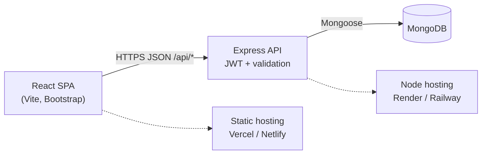
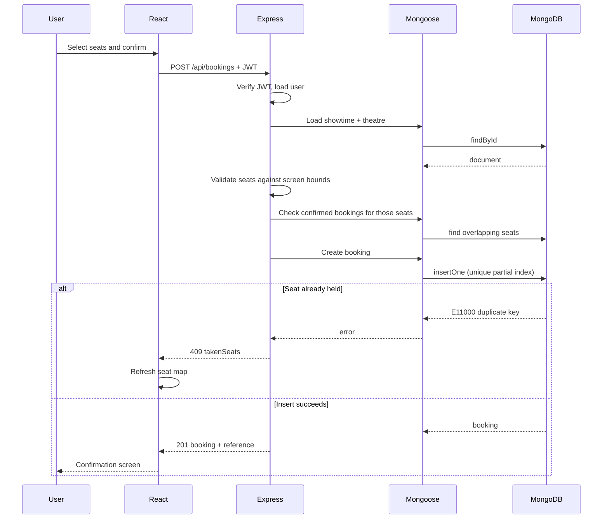

# IMovies — Technical Architecture

## 1. System overview

IMovies is a single-page React client talking to a stateless Express API backed by MongoDB. The API owns all business rules; the client never decides whether a seat can be booked.



| Layer | Responsibility |
|---|---|
| React client | Rendering, form state, route protection, optimistic UI for seat selection |
| Express API | Authentication, authorisation, validation, booking transactions |
| MongoDB | Durable storage, unique constraints, indexes |

## 2. MVC pattern

| Layer | Location | Responsibility |
|---|---|---|
| **Model** | `server/src/models` | Schema, validation, indexes, password hashing hook |
| **View** | `client/src` | React pages and components |
| **Controller** | `server/src/controllers` | Request parsing, business rules, response shaping |
| **Routes** | `server/src/routes` | URL → controller mapping, middleware attachment |
| **Middleware** | `server/src/middleware` | Authentication, role checks, error normalisation |

The client is deliberately thin. For example, the seat map is rendered from `rows` returned by the server, not generated independently.

## 3. Technology decisions

| Decision | Reason |
|---|---|
| Express 5 | Native async error propagation; smaller middleware surface |
| Mongoose | Schema-level validation and compound indexes |
| JWT in `Authorization: Bearer` | Stateless API, no server session store |
| bcrypt (cost 12) | Slow hashing protects leaked password hashes |
| Axios instance + interceptor | Single place to attach the token and normalise errors |
| React Context for auth | Session state is small; avoids a state library |
| Bootstrap + custom CSS | Responsive grid with a distinctive cinema theme |
| Unique partial index for seats | Makes double-booking impossible at the database level |

## 4. Request lifecycle



## 5. Authentication and authorisation

1. `POST /api/auth/register` hashes the password (bcrypt, cost 12) and returns a JWT.
2. `POST /api/auth/login` compares the password and issues a JWT containing `sub` (user id) and `role`.
3. `requireAuth()` verifies the token, loads the user and attaches `req.user`.
4. `requireAdmin` is `requireAuth('admin')`.
5. `GET /api/auth/me` lets the client restore a session on page load.

Tokens live in `localStorage` for simplicity. For a higher-security deployment, move them to `httpOnly` cookies with CSRF protection.

## 6. Data integrity rules

| Rule | Enforced by |
|---|---|
| Email uniqueness | Unique index on `User.email` |
| Password length ≥ 8 | Schema + controller |
| Seat must exist on the screen | `isValidSeat()` against `rows × seatsPerRow` |
| Max 10 seats per booking | Controller + schema validator |
| No duplicate active seats | Unique partial index on `Booking { showtime, seats }` |
| Cancelled seats are reusable | Partial index filters `status: 'confirmed'` |
| Cannot cancel after start | Controller compares `startTime` with now |
| Cannot delete a movie/theatre/screen in use | Controller counts dependent showtimes/bookings |

## 7. API design

- Base path: `/api`
- Success: `{ "success": true, "data": { ... } }`
- Failure: `{ "success": false, "message": "...", "details?": { ... } }`
- Status codes: `200`, `201`, `400` validation, `401` unauthenticated, `403` forbidden, `404` missing, `409` conflict, `422` schema validation.

Full endpoint list: [api.md](api.md).

## 8. Frontend structure

```text
App
├── Navbar / Footer
├── Public routes
│   ├── Home            featured movies + search
│   ├── Movies          search, genre chips, grid
│   ├── MovieDetail     metadata + showtimes by date/theatre
│   └── SeatBooking     seat map, summary, confirmation
├── Auth routes
│   ├── Login           redirect back to seat page
│   └── Register
├── Protected
│   ├── MyBookings      upcoming vs history, cancel
│   └── Admin           movies, theatres, showtimes, bookings
└── NotFound
```

Seat selections are mirrored to `sessionStorage`, so a guest who signs in mid-flow returns to their chosen seats.

## 9. Failure handling

| Failure | Behaviour |
|---|---|
| API unreachable | Message names port 5000 and suggests starting the server |
| Expired token | 401 → client clears session and redirects to login |
| Seat conflict (409) | Seats removed from selection, map refetched |
| Duplicate email | 409 with a clear message |
| Invalid MongoDB id | Cast error normalised to 400 |
| Validation failure | 422 with field-level `details` |

## 10. Scaling notes

- The API is stateless, so it can run behind a load balancer.
- Add a read replica and cache `GET /api/movies` for catalogue traffic.
- Move seat holds to Redis with TTL if you add a checkout timer.
- Replace `localStorage` JWTs with rotating refresh tokens for production-grade sessions.
- Add an index on `{ showtime: 1, status: 1 }` if booking volume grows.
