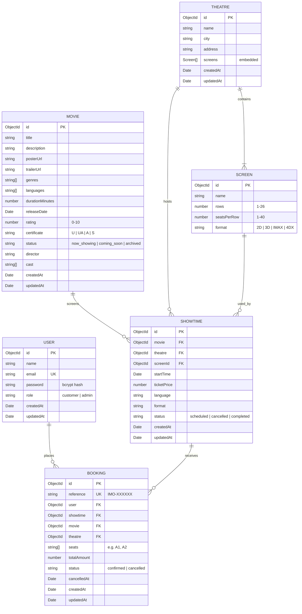

# IMovies — Entity Relationship Diagram

## Model diagram



## Relational view

| From | Cardinality | To | Notes |
|---|---|---|---|
| User | 1 → many | Booking | A customer can hold many bookings |
| Movie | 1 → many | Showtime | A movie can run at many times |
| Theatre | 1 → many | Screen | Screens are embedded documents |
| Theatre | 1 → many | Showtime | A theatre hosts many shows |
| Screen | 1 → many | Showtime | `screenId` points at an embedded screen |
| Showtime | 1 → many | Booking | One show has many bookings |

## Seat availability

Seats are **not** stored as rows in a collection. The screen stores `rows` and `seatsPerRow`; labels are generated as `A1 … Z40`.

Availability for a showtime is derived:

```text
all seats      = every label in rows × seatsPerRow
booked seats   = union of seats on confirmed bookings for that showtime
available     = all seats − booked seats
```

This keeps the schema small and means changing a screen's layout immediately changes future shows.

## Key indexes

| Collection | Index | Purpose |
|---|---|---|
| `users` | `{ email: 1 }` unique | Prevent duplicate accounts |
| `movies` | `{ title: "text", description: "text" }` | Full-text search |
| `movies` | `{ status: 1 }` | Filter now showing / coming soon |
| `showtimes` | `{ movie: 1, startTime: 1 }` | Movie detail page |
| `showtimes` | `{ theatre: 1, startTime: 1 }` | Theatre schedule |
| `bookings` | `{ reference: 1 }` unique | Booking lookup |
| `bookings` | `{ user: 1 }` | My bookings |
| `bookings` | `{ showtime: 1, seats: 1 }` unique, partial `status: "confirmed"` | **Prevents double booking** |

The partial unique index is the core integrity guarantee. A cancelled booking leaves the index, freeing its seats for the next customer.
