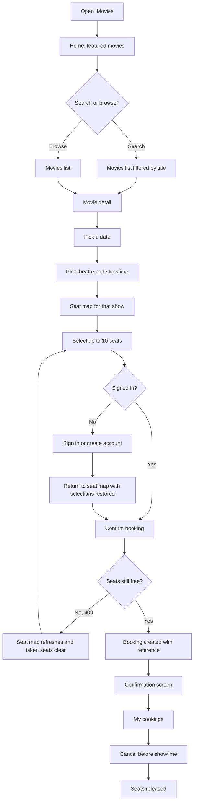
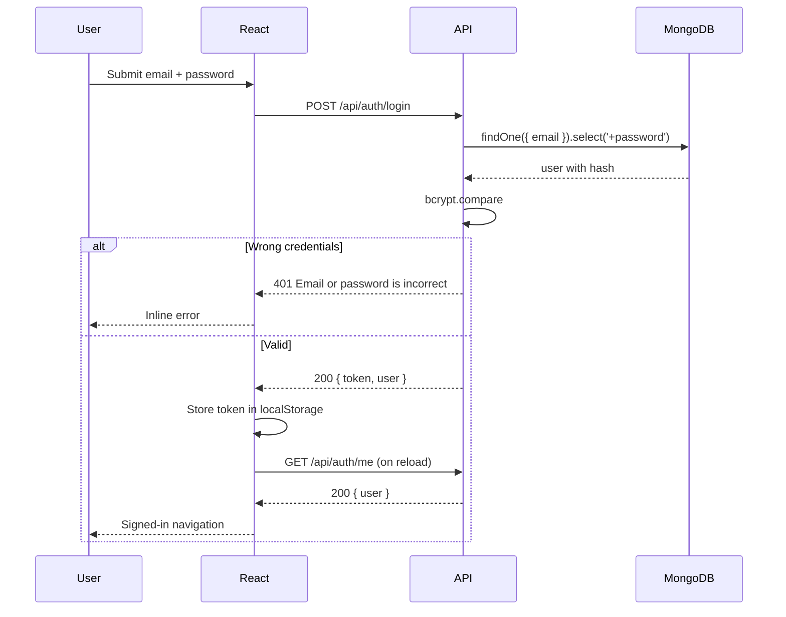
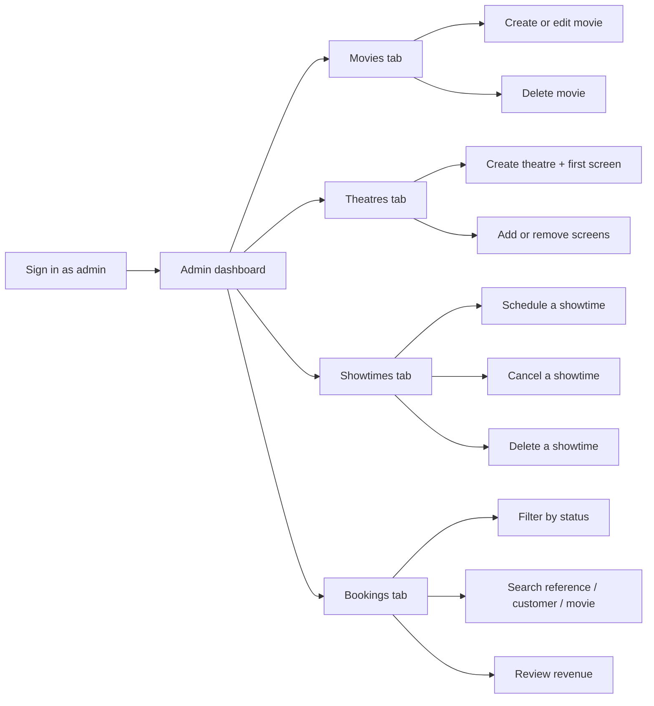
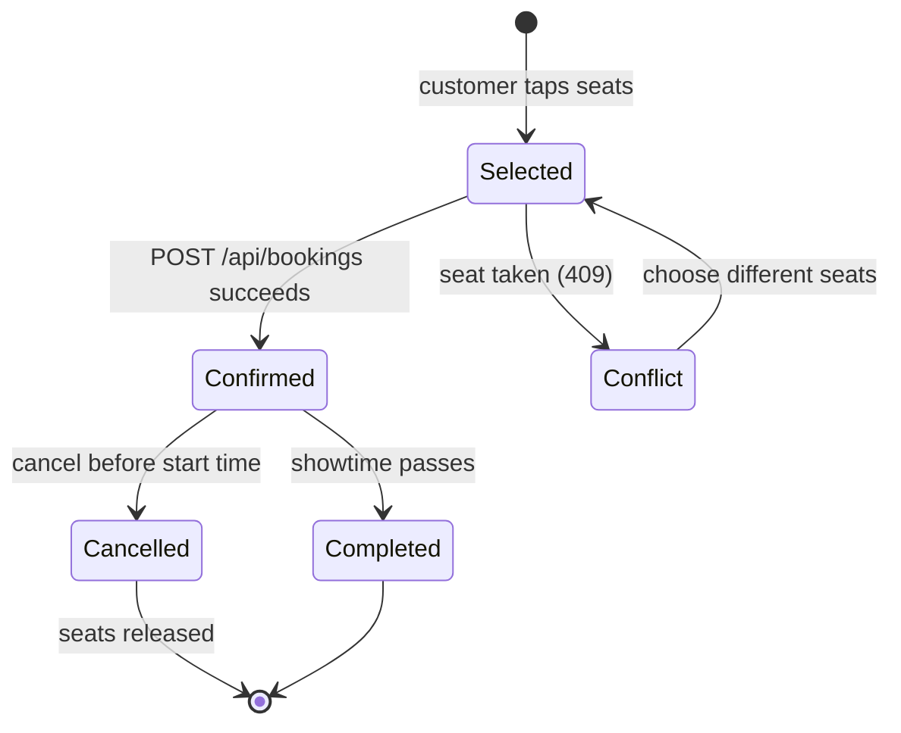

# IMovies — User Flow

## Customer journey

## Authentication flow

## Admin journey

## Booking state machine

## Guest-to-member hand-off

1. A guest selects seats on `/showtimes/:id/seats`.
2. The selection is stored in `sessionStorage` under `imovies.selection.<showtimeId>`.
3. Clicking **Sign in to book** redirects to `/login?redirect=/showtimes/<id>/seats`.
4. After login or registration the redirect returns to the same showtime.
5. The seat map reloads and restores any selected seats that are still available.

## Error paths

| Situation | What the customer sees |
|---|---|
| Seat taken between selection and confirm | Seats clear automatically and the map refreshes |
| Session expired | Redirect to sign in, then back to the flow |
| Showtime already started | Warning banner, confirm button disabled |
| Invalid seat label | 400 with `invalidSeats` details |
| More than 10 seats | Inline message on the seat panel |
| Cancelling after start | 409 with a clear explanation |
